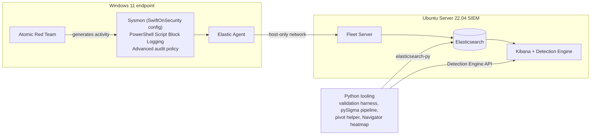

# Threat Detection Lab: Detection Engineering with Elastic, Sigma, and Atomic Red Team

A two-VM home SOC for practicing detection engineering end to end. A Windows 11 endpoint instrumented with Sysmon and PowerShell logging ships telemetry through Elastic Agent and Fleet to an Elastic Stack SIEM on Ubuntu. Attacks are emulated with Atomic Red Team, detections are written in Sigma and converted to EQL, every detection is checked by a Python validation harness, and fired alerts are worked into full investigation reports.

<!-- TODO: screenshot of the harness run with every detection passing -->

## Highlights

- **5 detections** written in Sigma, covering **5 ATT&CK tactics**, converted to EQL with a pySigma pipeline
- Every detection **validated against Atomic Red Team** by a Python harness that checks both the telemetry and the fired alert
- **3 investigation reports** with pivots, timelines, verdicts, and recommendations
- **ATT&CK Navigator coverage layer** generated from code
- **Baseline dashboard** of normal activity, built before any attack was run

## Architecture

Both VMs run on one 16 GB host under VMware. Lab traffic stays on a host-only network; the Ubuntu VM has a second NAT adapter for package installs. The Elasticsearch JVM heap is capped at 2 GB so the stack fits alongside the endpoint. More detail: [docs/architecture.md](docs/architecture.md).

## Tech Stack

- **SIEM:** Elasticsearch, Kibana, Fleet Server, Elastic Agent
- **Endpoint telemetry:** Sysmon (SwiftOnSecurity config), PowerShell Script Block Logging, Windows advanced audit policy
- **Adversary emulation:** Atomic Red Team (Invoke-AtomicRedTeam)
- **Detection:** Sigma, EQL, MITRE ATT&CK, ATT&CK Navigator
- **Python:** elasticsearch-py, pySigma
- **Infrastructure:** VMware, Ubuntu Server 22.04, Windows 11

## Detections

| # | Detection | Tactic | ATT&CK | Severity | Validated |
| --- | --- | --- | --- | --- | --- |
| 1 | [PowerShell download cradle](detections/T1059.001-powershell-download-cradle/) | Execution | T1059.001 | TBD | ⬜ |
| 2 | [Encoded PowerShell command](detections/T1027-encoded-powershell/) | Defense Evasion | T1027 | TBD | ⬜ |
| 3 | [Local account creation](detections/T1136.001-local-account-creation/) | Persistence | T1136.001 | TBD | ⬜ |
| 4 | [User added to local Administrators](detections/T1098-admin-group-add/) | Privilege Escalation | T1098 | TBD | ⬜ |
| 5 | [Failed logon burst](detections/T1110.001-failed-logon-burst/) | Credential Access | T1110.001 | TBD | ⬜ |

Each folder holds the Sigma rule, the converted EQL, and a README covering the logic, false positives, and a screenshot of the alert firing. Full index: [detections/README.md](detections/README.md).

## Validation

`scripts/validate_detections.py` runs after an atomic: it queries Elasticsearch for the expected telemetry, asks Kibana's Detection Engine API whether the matching rule fired, and records pass/fail. Usage: [scripts/README.md](scripts/README.md).

<!-- TODO: screenshot of a full harness run -->

## ATT&CK Coverage

`scripts/attack_heatmap.py` reads `scripts/coverage.yml` and generates an ATT&CK Navigator layer showing which emulated techniques have detections.

<!-- TODO: screenshot of the Navigator layer -->

## Investigations

| # | Investigation | Detection | Verdict |
| --- | --- | --- | --- |
| 001 | TBD | TBD | TBD |

Each report covers the trigger, initial indicators, pivots, timeline, verdict, and recommendations. Index: [investigations/README.md](investigations/README.md).

## Screenshots

<!-- TODO: baseline dashboard (dashboards/screenshots/), a fired alert, an investigation excerpt -->

## Documentation

- **Setup:** [VM and network](docs/setup/01-vm-and-network.md) · [Ubuntu + Elastic](docs/setup/02-ubuntu-elastic.md) · [Windows + Sysmon](docs/setup/03-windows-sysmon.md) · [Fleet enrollment](docs/setup/04-fleet-enrollment.md) · [Ingestion verification](docs/setup/05-ingestion-verification.md)
- [Atomic execution plan](atomics/execution-plan.md)
- [Dashboards](dashboards/README.md)
- [Lessons learned and troubleshooting](docs/lessons-learned.md)
